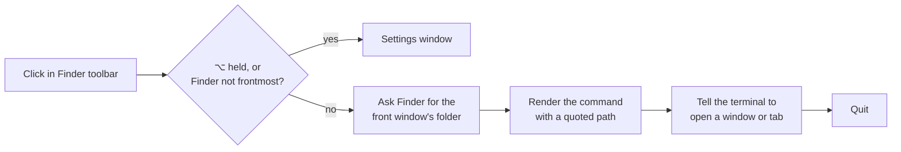

<p align="center">
  
</p>

<h1 align="center">Go2Shell</h1>

<p align="center">
  A Finder toolbar button for macOS: click it to open your terminal in the folder you are looking at.
</p>

<p align="center">
  
  
  
  
  <a href="LICENSE"></a>
</p>

<p align="center">
  <b>English</b> · <a href="README.zh-CN.md">简体中文</a>
</p>

---

## Why

The original Go2Shell 2.5 by ZipZapMac is an Intel-only app that has not been updated in years. It runs on Apple Silicon only through Rosetta 2, and after a macOS update it stopped working properly.

This project is a new app, written from scratch in Swift, that does the same job on current macOS. It keeps the name and the way of working, and it picks up your old Go2Shell settings the first time it runs.

> **Status: in development.** The core works, but there is no packaged release yet, so you build it from source. See [Supported terminals](#supported-terminals) and [Known limitations](#known-limitations) for what has and has not been tested.

## Features

- **One click from Finder.** Opens your terminal in the folder shown in the front Finder window, then quits. No Dock icon, nothing left running.
- **Custom command.** Choose what runs in the new session. The default is `cd %PATH%; clear; pwd`.
- **Safe with any folder name.** `%PATH%` is replaced by a shell-quoted path, so spaces, quotes, `$`, backticks and non-ASCII names work without extra quoting.
- **New window or new tab.**
- **Selected folder first** (optional). With exactly one folder selected in Finder, open that folder instead of the window's folder.
- **Migrates from the original Go2Shell.** Terminal, command and window mode are imported once on first run.
- **Clear errors.** Missing Automation permission, virtual locations such as Recents or AirDrop, and deleted folders each get an alert that says what to do.
- **English and Simplified Chinese**, following the system language.

## Supported terminals

| Terminal | Opens in folder | Runs custom command | New tab | Tested |
| --- | --- | --- | --- | --- |
| Terminal.app | Yes | Yes | Experimental | Cold and warm start |
| iTerm2 | Yes | Yes | Yes | Warm start; cold start pending |
| Ghostty, WezTerm, kitty, Alacritty, Warp | Yes | No | No | Implemented, not yet verified one by one |

- If the terminal you chose is not installed, Go2Shell uses Terminal.app.
- Terminal.app has no scripting command for a new tab, so Go2Shell simulates ⌘T. This needs Accessibility permission; without it, Go2Shell opens a new window.

## Requirements

- macOS 14 or later
- Xcode or the Xcode Command Line Tools (Swift 6 toolchain), to build from source

## Install

There is no packaged release yet. Build and install from source:

```sh
git clone https://github.com/bingghost/go2shell.git
cd go2shell
./install.sh
```

`install.sh` builds a release bundle, copies it to `/Applications/Go2Shell.app`, opens the settings window and removes the build products.

> **If the original Go2Shell 2.5 is installed:** it uses the same path, `/Applications/Go2Shell.app`. The installer does not delete it. It moves it to `~/Library/Application Support/Go2Shell/Replaced Apps/`, and its settings are still imported on first run.

The build signs with the first "Apple Development" certificate in your keychain. Without one it falls back to ad-hoc signing, and macOS then asks for Automation permission again after every rebuild.

## Quick start

1. Open the Applications folder, hold **⌘**, and drag Go2Shell onto the toolbar of any Finder window.
2. Open a folder in Finder and click the Go2Shell button.
3. The first time, macOS asks whether Go2Shell may control Finder and your terminal. Allow both.
4. Your terminal opens in that folder and Go2Shell quits.

To change settings, hold **⌥** while clicking the toolbar button, or open Go2Shell from the Applications folder.

## Settings

| Setting | What it does | Default |
| --- | --- | --- |
| Open folders in | The terminal to open | Terminal.app |
| Command | Runs in the new session; `%PATH%` stands for the folder. The window shows a live preview. | `cd %PATH%; clear; pwd` |
| Open in | New window or new tab | New window |
| When one folder is selected, open that folder | See "Selected folder first" above | Off |

Do not put quotes around `%PATH%`. An empty command behaves like `cd %PATH%`, and a command without `%PATH%` gets `cd <folder>;` put in front of it.

| Template | Runs, for the folder `/Users/you/My Project` |
| --- | --- |
| `cd %PATH%; clear; pwd` | `cd '/Users/you/My Project'; clear; pwd` |
| `cd %PATH% && ls -la` | `cd '/Users/you/My Project' && ls -la` |
| `clear` | `cd '/Users/you/My Project'; clear` |

## How it works



Two design rules keep folder names from being interpreted as code:

- **AppleScript source is constant.** Paths and commands are passed to script handlers as Apple Event parameters and are never spliced into script text.
- **Paths are always shell-quoted.** The only text that reaches a shell is the rendered command template, with the path wrapped in POSIX single quotes.

Terminals without a scripting interface (Ghostty, WezTerm, kitty, Alacritty, Warp) are launched through `NSWorkspace`, with no shell involved.

## Troubleshooting

| Symptom | What to do |
| --- | --- |
| "Go2Shell is not allowed to control …" | Turn the switch on in System Settings › Privacy & Security › Automation. If Go2Shell is not listed, run `tccutil reset AppleEvents com.bingghost.Go2Shell` and click the button again. |
| Permission is requested after every rebuild | The build was signed ad-hoc. Build with a certificate: `make build SIGN_ID=<identity>`. |
| The settings window opens instead of a terminal | ⌥ was held, or Go2Shell was not started from Finder. |
| Terminal.app opens instead of your terminal | The chosen terminal is not installed. |
| The custom command does not run | Only Terminal.app and iTerm2 can run a command. |

To watch what Go2Shell does:

```sh
log stream --level debug --predicate 'subsystem == "com.bingghost.Go2Shell"'
```

## Uninstall

```sh
make uninstall                            # removes /Applications/Go2Shell.app
defaults delete com.bingghost.Go2Shell    # removes the settings
```

Hold **⌘** and drag the button off the Finder toolbar to remove it.

## Known limitations

- No packaged release, no notarization, no automatic updates.
- Third-party terminals only open in the folder. They cannot run the custom command or open a new tab.
- Not yet tested by hand: iTerm2 cold start, clicking from the toolbar, ⌥-click, the alert after denying permission, and the Terminal.app new-tab path.
- You add the button to the toolbar yourself; there is no one-click toolbar installer.
- Tested on Apple Silicon only. A universal build is available with `make build UNIVERSAL=1` but has not been tested on an Intel Mac.

## Development

The project is a Swift package with a Makefile that assembles and signs the `.app`. There is no Xcode project.

```sh
make build        # build and sign .build/Go2Shell.app
make test         # run the unit tests
./start.sh        # build a debug bundle and run it in the foreground
./clean.sh        # remove build products
make help         # list all make targets
```

Flags for running without the Finder toolbar:

```sh
./start.sh --print-finder-path    # print the folder of the front Finder window
./start.sh --open ~/Downloads     # open the configured terminal in a folder
./start.sh --settings             # open the settings window
```

Run from a shell, Automation permission belongs to the terminal you ran it from, not to Go2Shell. `make reset-tcc` resets the permission for Go2Shell.

| Path | Contents |
| --- | --- |
| `Sources/Go2ShellCore` | Pure logic with unit tests: shell quoting, command template, terminal capabilities, settings, launch routing. Does not import AppKit. |
| `Sources/Go2Shell` | The app: Finder lookup, terminal launchers, settings window, error alerts. |
| `Tests/Go2ShellCoreTests` | Unit tests (Swift Testing). |
| `Scripts/make-icon.swift` | Draws the app icon; run it with `make icon`. |

Design documents are in [`docs/`](docs/) and are written in Chinese:

- [User guide](docs/USAGE.md)
- [Product requirements](docs/01-PRD.md)
- [Technical design](docs/02-TECH-DESIGN.md)
- [Requirements list](docs/03-REQUIREMENTS.md)
- [Development plan and progress](docs/04-DEV-PLAN.md)

## Contributing

Issues and pull requests are welcome. Before opening a pull request, run `make test` and `make build`. Reports about a specific terminal are especially useful: include the terminal's version, your macOS version, and the output of the `log stream` command above.

## How this project was built

The code was written with Claude Opus 5.5 and then reviewed and refined with Claude Fable 5.2, both through Claude Code, under the author's direction. The requirements, design and milestone plan that guided the work are kept in [`docs/`](docs/).

## Acknowledgements

- **Go2Shell by ZipZapMac**, the original app this project replaces. Its behaviour and settings were the reference for what this app should do. This project is not affiliated with ZipZapMac and contains none of its code.
- **[solarhell/go2shell](https://github.com/solarhell/go2shell)**, an open-source alternative that was consulted for ideas. No code was copied from it.

## License

Released under the [MIT License](LICENSE).

The license covers the code in this repository. The name "Go2Shell" comes from the original app by ZipZapMac, and this project is not affiliated with it.
