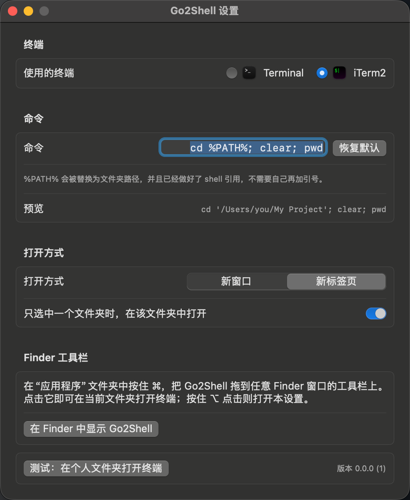
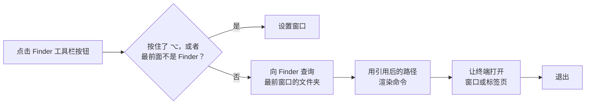

<p align="center">
  
</p>

<h1 align="center">Go2Shell</h1>

<p align="center">
  放在 Finder 工具栏上的 macOS 小按钮：点一下，就在当前文件夹打开你的终端。
</p>

<p align="center">
  
  
  
  
  <a href="LICENSE"></a>
</p>

<p align="center">
  <a href="README.md">English</a> · <b>简体中文</b>
</p>

---

## 为什么做这个

ZipZapMac 的原版 Go2Shell 2.5 只有 Intel 版本，多年没有更新。它在 Apple Silicon 上只能靠 Rosetta 2 运行，macOS 更新之后已经不能正常使用。

这个项目是用 Swift 从头写的一个新 App，在当前的 macOS 上做同样的事。它沿用了原来的名字和使用方式，第一次运行时会读取原版 Go2Shell 的设置。

> **当前状态：开发中。** 核心功能已经可用，但还没有发布安装包，需要自己从源码构建。哪些已经测过、哪些还没有，见[支持的终端](#支持的终端)和[已知限制](#已知限制)。

## 功能

- **在 Finder 里一键打开。** 在最前面那个 Finder 窗口的文件夹里打开终端，然后自动退出。不出现 Dock 图标，也不留后台进程。
- **自定义命令。** 新会话里执行什么命令可以自己定，默认是 `cd %PATH%; clear; pwd`。
- **任何文件夹名都安全。** `%PATH%` 会被替换成已做好 shell 引用的路径，文件夹名里有空格、引号、`$`、反引号、中文都不需要自己加引号。
- **新窗口或新标签页。**
- **选中文件夹优先**（可选）。在 Finder 里恰好选中一个文件夹时，在该文件夹里打开，而不是窗口当前的文件夹。
- **从原版 Go2Shell 迁移。** 第一次运行时导入终端、命令和窗口模式，只导入一次。
- **出错有明确提示。** 没有自动化权限、当前是「最近使用」「隔空投送」这类虚拟位置、文件夹已被删除，各有一个说明该怎么办的弹窗。
- **中英文界面**，跟随系统语言。

## 支持的终端

| 终端 | 在文件夹中打开 | 执行自定义命令 | 新标签页 | 测试情况 |
| --- | --- | --- | --- | --- |
| Terminal.app | 支持 | 支持 | 实验性 | 冷启动和热启动已实测 |
| iTerm2 | 支持 | 支持 | 支持 | 热启动已实测，冷启动待测 |
| Ghostty、WezTerm、kitty、Alacritty、Warp | 支持 | 不支持 | 不支持 | 代码已实现，尚未逐个实测 |

- 选定的终端没有安装时，Go2Shell 改用 Terminal.app。
- Terminal.app 没有打开新标签页的脚本命令，Go2Shell 通过模拟 ⌘T 实现。这需要辅助功能权限；没有权限时改为打开新窗口。

## 环境要求

- macOS 14 或更高版本
- 从源码构建需要 Xcode 或 Xcode 命令行工具（Swift 6 工具链）

## 安装

目前没有发布安装包，需要从源码构建并安装：

```sh
git clone https://github.com/bingghost/go2shell.git
cd go2shell
./install.sh
```

`install.sh` 会构建 release 版本、复制到 `/Applications/Go2Shell.app`、打开设置窗口，然后清理编译产物。

> **如果装着原版 Go2Shell 2.5：** 它用的是同一个路径 `/Applications/Go2Shell.app`。安装脚本不会删除它，而是把它移到 `~/Library/Application Support/Go2Shell/Replaced Apps/`；它的设置在第一次运行时仍会被导入。

构建时用钥匙串里第一个 "Apple Development" 证书签名。没有证书时改用 ad-hoc 签名，这种情况下每次重新构建后 macOS 都会重新询问自动化权限。

## 快速开始

1. 打开「应用程序」文件夹，按住 **⌘**，把 Go2Shell 拖到任意 Finder 窗口的工具栏上。
2. 在 Finder 里打开一个文件夹，点击 Go2Shell 按钮。
3. 第一次点击时，macOS 会询问是否允许 Go2Shell 控制 Finder 和你的终端，两个都选允许。
4. 终端在该文件夹打开，Go2Shell 自动退出。

要修改设置，按住 **⌥** 点击工具栏按钮，或者从「应用程序」里打开 Go2Shell。

## 设置

<p align="center">
  
</p>

| 设置项 | 作用 | 默认值 |
| --- | --- | --- |
| 使用的终端 | 打开哪个终端 | Terminal.app |
| 命令 | 在新会话里执行；`%PATH%` 代表文件夹。设置窗口里有实时预览。 | `cd %PATH%; clear; pwd` |
| 打开方式 | 新窗口或新标签页 | 新窗口 |
| 只选中一个文件夹时，在该文件夹中打开 | 见上文「选中文件夹优先」 | 关闭 |

不要给 `%PATH%` 加引号。命令留空时相当于 `cd %PATH%`；命令里没有 `%PATH%` 时，会在前面自动加上 `cd <文件夹>;`。

| 模板 | 文件夹是 `/Users/you/My Project` 时实际执行 |
| --- | --- |
| `cd %PATH%; clear; pwd` | `cd '/Users/you/My Project'; clear; pwd` |
| `cd %PATH% && ls -la` | `cd '/Users/you/My Project' && ls -la` |
| `clear` | `cd '/Users/you/My Project'; clear` |

每个设置的详细说明、权限和更多常见问题，见[使用文档](docs/USAGE.md)。

## 工作原理



两条设计规则保证文件夹名不会被当成代码执行：

- **AppleScript 源码是常量。** 路径和命令作为 Apple Event 参数传给脚本里的 handler，从不拼接进脚本文本。
- **路径一律做 shell 引用。** 进入 shell 的只有渲染后的命令模板，其中的路径用 POSIX 单引号整体包住。

没有脚本接口的终端（Ghostty、WezTerm、kitty、Alacritty、Warp）通过 `NSWorkspace` 启动，不经过 shell。

## 常见问题

| 现象 | 处理办法 |
| --- | --- |
| 弹出「Go2Shell 没有控制"…"的权限」 | 在「系统设置 › 隐私与安全性 › 自动化」里打开对应开关。列表里没有 Go2Shell 时，执行 `tccutil reset AppleEvents com.bingghost.Go2Shell`，再点一次按钮。 |
| 每次重新构建后都要重新授权 | 构建用的是 ad-hoc 签名。改用证书构建：`make build SIGN_ID=<证书>`。 |
| 打开的是设置窗口，不是终端 | 点击时按住了 ⌥，或者 Go2Shell 不是从 Finder 启动的。 |
| 打开的是 Terminal.app，不是选定的终端 | 选定的终端没有安装。 |
| 自定义命令没有执行 | 只有 Terminal.app 和 iTerm2 能执行命令。 |

查看 Go2Shell 的运行日志：

```sh
log stream --level debug --predicate 'subsystem == "com.bingghost.Go2Shell"'
```

## 卸载

```sh
make uninstall                            # 删除 /Applications/Go2Shell.app
defaults delete com.bingghost.Go2Shell    # 删除设置
```

按住 **⌘** 把按钮拖出 Finder 工具栏，即可移除它。

## 已知限制

- 没有发布安装包，没有做公证，没有自动更新。
- 第三方终端只能在文件夹中打开，不能执行自定义命令，也不能开新标签页。
- 尚未手工测试：iTerm2 冷启动、从工具栏点击、按住 ⌥ 点击、拒绝授权后的弹窗、Terminal.app 的新标签页。
- 需要自己把按钮拖到工具栏，没有一键安装到工具栏的功能。
- 只在 Apple Silicon 上测试过。可以用 `make build UNIVERSAL=1` 构建通用版本，但没有在 Intel Mac 上测试。

## 开发

项目是一个 Swift package，由 Makefile 组装并签名 `.app`，没有 Xcode 工程。

```sh
make build        # 构建并签名 .build/Go2Shell.app
make test         # 运行单元测试
./start.sh        # 构建 debug 版本并在前台运行
./clean.sh        # 删除编译产物
make help         # 列出全部 make 目标
```

不经过 Finder 工具栏的运行参数：

```sh
./start.sh --print-finder-path    # 打印 Finder 最前窗口的文件夹
./start.sh --open ~/Downloads     # 按当前设置在指定文件夹打开终端
./start.sh --settings             # 打开设置窗口
```

从 shell 运行时，自动化权限属于运行它的那个终端，而不是 Go2Shell。`make reset-tcc` 可以重置 Go2Shell 的权限。

| 路径 | 内容 |
| --- | --- |
| `Sources/Go2ShellCore` | 带单元测试的纯逻辑：shell 引用、命令模板、终端能力、设置、启动分流。不 import AppKit。 |
| `Sources/Go2Shell` | App 本体：查询 Finder、各终端的启动器、设置窗口、错误弹窗。 |
| `Tests/Go2ShellCoreTests` | 单元测试（Swift Testing）。 |
| `Scripts/make-icon.swift` | 绘制应用图标，用 `make icon` 运行。 |

设计文档在 [`docs/`](docs/)：

- [使用文档](docs/USAGE.md)
- [产品需求](docs/01-PRD.md)
- [技术设计](docs/02-TECH-DESIGN.md)
- [需求清单](docs/03-REQUIREMENTS.md)
- [开发计划与进度](docs/04-DEV-PLAN.md)

## 参与贡献

欢迎提 issue 和 pull request。提交 pull request 之前请先运行 `make test` 和 `make build`。针对某个具体终端的反馈尤其有用：请附上终端版本、macOS 版本，以及上面 `log stream` 命令的输出。

## 这个项目是怎么写出来的

代码由 Claude Opus 5.5 编写，再由 Claude Fable 5.2 审查和优化，两者都通过 Claude Code 在作者的主导下完成。指导开发的需求、设计和里程碑计划都保存在 [`docs/`](docs/) 里。

## 致谢

- **ZipZapMac 的 Go2Shell**，本项目要替代的原版 App。它的行为和设置项是本项目的功能参照。本项目与 ZipZapMac 没有关联，也不包含它的代码。
- **[solarhell/go2shell](https://github.com/solarhell/go2shell)**，一个开源替代品，开发时参考了它的思路，没有复制其中的代码。

## 许可

以 [MIT 许可证](LICENSE) 发布。

许可证针对的是本仓库里的代码。「Go2Shell」这个名字来自 ZipZapMac 的原版 App，本项目与它没有关联。
